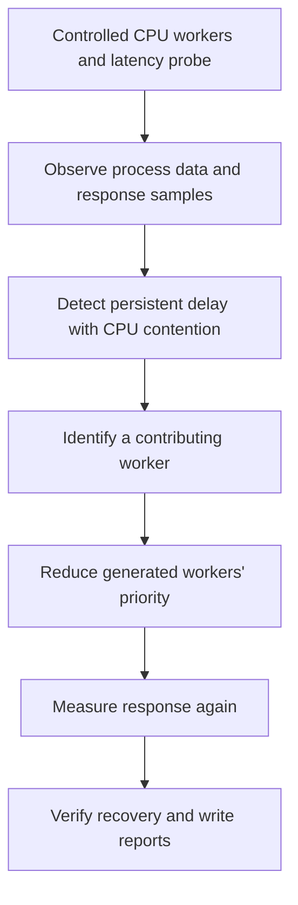

# FreezeDoctor

## 5th Semester OS Lab Project

**OS-Based Detection and Recovery of Process Scheduling Starvation in Linux**

FreezeDoctor is a **C++17 Linux project** that demonstrates how CPU contention affects process responsiveness and how a controlled scheduling-priority adjustment can improve it. It creates real processes, observes their CPU activity, measures response delays, applies recovery, and verifies the result using fresh measurements.

**Observe → Detect → Identify → Recover → Verify**

[](https://github.com/asgt2408/FreezeDoctor/actions/workflows/ci.yml)

## Contents

- [Our team](#our-team)
- [About the project](#about-the-project)
- [Problem statement and objectives](#problem-statement-and-objectives)
- [How the working model operates](#how-the-working-model-operates)
- [Architecture and modules](#architecture-and-modules)
- [Operating Systems concepts demonstrated](#operating-systems-concepts-demonstrated)
- [Technology and requirements](#technology-and-requirements)
- [Installation and execution](#installation-and-execution)
- [Commands and configuration](#commands-and-configuration)
- [Detection and recovery criteria](#detection-and-recovery-criteria)
- [Measured demonstration results](#measured-demonstration-results)
- [Project structure](#project-structure)
- [Testing](#testing)
- [Scope and limitations](#scope-and-limitations)
- [Documentation and references](#documentation-and-references)

## Our team

We are a team of B.Tech Computer Science and Engineering students at **Jaypee Institute of Information Technology**, developing FreezeDoctor as our **5th Semester Operating Systems Lab Project**.

| Team member |
| --- |
| Ashu Gupta |
| Nishant Kumar |
| Aanya Mahajan |
| Atharv Rawal |

| Academic detail | Information |
| --- | --- |
| Institute | Jaypee Institute of Information Technology |
| Department | Computer Science & Engineering |
| Program | B.Tech CSE |
| Year and semester | 3rd Year, 5th Semester |
| Project category | Operating Systems Lab / Project-Based Learning (PBL) |
| Course | Operating System |
| Course code | 24B15CS312 |
| Academic session | 2026–2027 |
| Submitted to | Mr. Twinkle Tyagi |

## About the project

An application can remain alive while becoming slow to respond because other processes are competing for CPU time. FreezeDoctor investigates this condition through a controlled Linux experiment.

A latency-sensitive probe performs small periodic CPU jobs while CPU-intensive worker processes compete with it. The program connects the probe's measured response delays with live process information from `/proc`. When persistent delay and workload CPU consumption occur together, it identifies a contributing worker and reduces the generated workers' scheduling priority using `setpriority()`.

The probe continues running after the intervention. FreezeDoctor compares its response measurements before and after the priority change and reports whether recovery was verified. The project runs in user space using Linux's existing scheduler.

## Problem statement and objectives

High CPU usage alone does not establish which process is responding slowly or whether a scheduling intervention helps. The project's goal is to connect observation, diagnosis, action, and quantitative verification in one working model.

The main objectives are to:

1. Create and control real Linux processes for a repeatable experiment.
2. Measure the response delay of a selected latency-sensitive process.
3. Detect persistent abnormal delay correlated with CPU contention.
4. Identify a contributing CPU-intensive workload using process accounting.
5. Apply a controlled priority reduction to the generated workers.
6. Compare before/after measurements and produce an evidence-based report.

## How the working model operates

The default demonstration has three phases, each lasting four seconds.

| Phase | What happens | What is measured |
| --- | --- | --- |
| **A — Baseline** | The probe runs without FreezeDoctor's generated workers. | Normal response time, used to calculate a local detection threshold. |
| **B — CPU contention** | Four CPU-bound workers compete with the probe on the same logical CPU. | Probe response time, worker CPU utilization, and persistent abnormal windows. |
| **C — Recovery and verification** | If contention was detected, the generated workers' nice values are changed to 19. The probe continues unchanged. | Response time after intervention, compared with Phase B. |

The probe and workers share one CPU selected from the process's permitted affinity mask. This makes CPU contention observable even on a multi-core machine.

The probe performs approximately **2 ms of CPU work** per release, normally every **10 ms**. Response time is elapsed wall time from the scheduled release to completion; it includes wake-up delay, CPU service, and preemption. Wake-up delay is also recorded separately. Missed releases are skipped to prevent an indefinitely growing backlog.

## Architecture and modules



These logical modules are implemented in [`src/freezedoctor.cpp`](src/freezedoctor.cpp).

| Module | Responsibility |
| --- | --- |
| Workload generator | Creates the probe and CPU-bound workers using `fork()`. |
| System observation | Reads `/proc/<pid>/stat` and, where available, `/proc/<pid>/schedstat`. |
| Starvation analyzer | Correlates abnormal response delay with measured worker CPU usage over consecutive windows. |
| Recovery | Calls `getpriority()` and `setpriority()` on the experiment's own workers and checks the resulting nice values. |
| Verification | Calculates sample count, mean, nearest-rank p95, and maximum response time. |
| Reporting | Prints live terminal observations and exports JSON summaries and raw CSV measurements. |

## Operating Systems concepts demonstrated

| OS concept | Application in FreezeDoctor |
| --- | --- |
| Process creation | Separate probe and worker processes created with `fork()`. |
| CPU scheduling and contention | Runnable processes compete on a shared logical CPU. |
| CPU affinity | `sched_setaffinity()` controls where experimental processes execute. |
| Process priorities | Nice-value changes alter the workers' relative scheduling priority. |
| Process accounting | `/proc` CPU tick deltas provide workload CPU evidence. |
| Timing | Monotonic wall-clock timing measures response; process CPU timing controls job size. |
| Shared memory and synchronization | `mmap()` shares probe samples; a lock-free atomic counter publishes complete samples. |
| Signals and lifecycle | Signals stop test processes during cleanup; `waitpid()` reaps them. |

## Technology and requirements

| Component | Requirement |
| --- | --- |
| Language | C++17 |
| Compiler | G++ with C++17 support |
| Operating system | Linux; WSL2 or a Linux VM can also be used |
| Build tool | Make |
| Linux facilities | `/proc`, POSIX clocks, process control, CPU affinity, and priority APIs |
| Test runner | Python 3, needed only for integration tests |
| Third-party application libraries | None |

The C++ implementation uses `std::array` for fixed-size storage, `std::vector` and `std::sort` for statistics, file/string streams for process-data parsing, `std::atomic` for publishing samples, and `std::unique_ptr` with a custom deleter for shared-memory cleanup.

## Installation and execution

### 1. Install prerequisites

On Debian/Ubuntu or Ubuntu under WSL2:

```bash
sudo apt-get update
sudo apt-get install build-essential python3 git
```

### 2. Clone and build

```bash
git clone https://github.com/asgt2408/FreezeDoctor.git
cd FreezeDoctor
make
```

### 3. Run the working demonstration

```bash
make demo
```

The default run takes approximately **12 seconds**, prints live measurements, and creates:

| Output | Contents |
| --- | --- |
| `results/report.json` | Detection evidence, process IDs, worker priority changes, phase statistics, and verification outcome. |
| `results/samples.csv` | Individual response/wake-delay measurements and the associated window's aggregate workload CPU usage. |

Inspect the report with:

```bash
python3 -m json.tool results/report.json
```

Run the experiment as a normal user. Administrator access is needed only for installing missing system packages. Press **Ctrl+C** to interrupt the demonstration and clean up its child processes.

### Compile directly for the C++ lab

```bash
g++ -std=c++17 -O2 -Wall -Wextra -Wpedantic src/freezedoctor.cpp -o freezedoctor
./freezedoctor
```

## Commands and configuration

```bash
./build/freezedoctor --help
./build/freezedoctor --seconds 6 --workers 4
./build/freezedoctor --no-recovery
make test
```

| Option | Meaning | Default |
| --- | --- | --- |
| `--seconds N` | Duration of each phase; accepts 2–60 seconds. | 4 |
| `--workers N` | Number of competing workers; accepts 1–16. | 4 |
| `--cpu N` | Logical CPU from the current permitted affinity mask. | First permitted CPU |
| `--report PATH` | JSON report location. | `report.json` |
| `--csv PATH` | CSV sample location. | `samples.csv` |
| `--no-recovery` | Runs the control experiment without changing priorities. | Recovery enabled |
| `--help` | Displays usage. | — |

`make demo` supplies paths under `results/`. For custom output paths, create the parent directories first. Existing output files at those paths are overwritten.

For a comparison run without intervention:

```bash
mkdir -p results
./build/freezedoctor --no-recovery --report results/control.json --csv results/control.csv
```

## Detection and recovery criteria

### Detecting contention

FreezeDoctor evaluates consecutive **500 ms observation windows**. A window qualifies when:

- Its mean probe response exceeds `max(1.5 × baseline mean, baseline mean + 1 ms)`.
- Generated workers consume at least **30% of one logical CPU**.

The condition must persist for **three consecutive windows**. The highest-CPU worker in the most recent qualifying window is recorded as a contributing process. Recovery is applied at the end of the fixed contention phase, preserving a complete before-intervention observation period.

### Applying recovery

All generated workers are known competitors in this controlled experiment. FreezeDoctor lowers their scheduling priority by changing their nice values to **19**, then checks the actual values. The probe's priority remains unchanged.

### Verifying recovery

`RECOVERY VERIFIED` requires all of the following:

1. Persistent contention was detected.
2. Every generated worker's priority was successfully reduced.
3. Baseline, before, and after phases each contain at least 10 samples.
4. Mean response time decreases by **more than 10%** from the contention phase.
5. The after-intervention p95 response time is lower than the before-intervention p95.

Otherwise, the program reports `RECOVERY NOT VERIFIED`. The `--no-recovery` control cannot claim verified recovery, even if response times improve naturally.

## Measured demonstration results

The committed C++ example produced these measurements on the development Linux host:

| Measurement | Baseline | CPU contention | After priority adjustment |
| --- | --- | --- | --- |
| Samples | 398 | 236 | 398 |
| Mean response | 2.699 ms | 10.888 ms | 2.738 ms |
| p95 response | 4.696 ms | 20.958 ms | 5.975 ms |

**Observed mean response improvement: 74.853%. Recovery verified: yes.**

All four workers changed from nice **0 → 19**. The results are actual measurements from one run; new runs produce host-dependent values.

Inspect the evidence:

- [JSON example report](docs/example-report.json)
- [Raw CSV samples](docs/example-samples.csv)
- [Full terminal session](docs/example-run.txt)

## Project structure

```text
FreezeDoctor/
├── src/
│   └── freezedoctor.cpp       # C++17 experiment, analysis, recovery, and reporting
├── tests/
│   └── test_freezedoctor.py   # Real-process integration tests
├── docs/
│   ├── DEMONSTRATION.md       # Presentation steps, troubleshooting, and viva guide
│   ├── DESIGN.md              # Implementation details and experimental limitations
│   ├── example-report.json    # Recorded C++ demonstration summary
│   ├── example-samples.csv    # Measurements behind the summary
│   └── example-run.txt        # Recorded terminal output
├── .github/workflows/ci.yml   # Automated C++ build and test workflow
├── .clang-format             # Source formatting configuration
├── .gitignore
├── Makefile
└── README.md
```

`build/` and `results/` are generated locally and excluded from version control.

## Testing

```bash
make test
```

The four integration tests check:

- Invalid command-line argument handling.
- Consistency between raw CSV measurements and JSON statistics, actual priority values, and normal process cleanup.
- Control-run behavior when recovery is disabled.
- Child-process cleanup when the controller is interrupted.

GitHub Actions builds the C++17 source with strict compiler warnings and runs these tests on Linux. Tests validate report integrity and lifecycle behavior without requiring particular latency values on shared CI machines.

## Scope and limitations

FreezeDoctor demonstrates **excessive scheduling delay under CPU contention**. Linux's fair scheduler generally continues giving runnable processes CPU time, so the experiment does not establish indefinite starvation.

Only processes created by the current invocation are priority targets. No external PID is accepted. Workers are terminated only when cleaning up the experiment; termination is not used as the recovery mechanism. `waitpid()` reaps children, and `PR_SET_PDEATHSIG` requests their termination if the controller unexpectedly exits.

The project does not modify the kernel or implement a replacement scheduler. Its mandatory scope is CPU scheduling; memory-thrashing recovery, disk-I/O recovery, machine learning, and general-purpose system monitoring are outside the implementation.

Containers, CPU quotas, unrelated host activity, inherited nice values, and scheduler configuration can affect the outcome. A nice value of 19 lowers relative scheduling priority; it does not stop the worker or impose a hard CPU cap. No improvement is guaranteed, and unsuccessful outcomes remain visible in the report. Repeat independent runs for academic evaluation.

Native Windows and macOS are unsupported; use Linux, WSL2, or a Linux VM. See the [demonstration guide](docs/DEMONSTRATION.md) for troubleshooting.

| Exit code | Meaning |
| --- | --- |
| `0` | Experiment completed; check `recovery_verified` in JSON for the recovery outcome. |
| `1` | Operational error. |
| `2` | Invalid arguments. |
| `130` | Interrupted; an interrupted baseline may leave incomplete output files. |

## Documentation and references

- [Demonstration and viva guide](docs/DEMONSTRATION.md)
- [Detailed design and synopsis mapping](docs/DESIGN.md)
- [Linux scheduler documentation](https://docs.kernel.org/scheduler/)
- [Linux man-pages project](https://www.kernel.org/doc/man-pages/): `fork(2)`, `waitpid(2)`, `sched_setaffinity(2)`, `getpriority(2)`, `setpriority(2)`, `clock_gettime(2)`, `clock_nanosleep(2)`, `proc_pid_stat(5)`, and `prctl(2)`.

The project follows the FreezeDoctor PBL synopsis submitted for the **5th Semester Operating Systems Lab** at Jaypee Institute of Information Technology.
